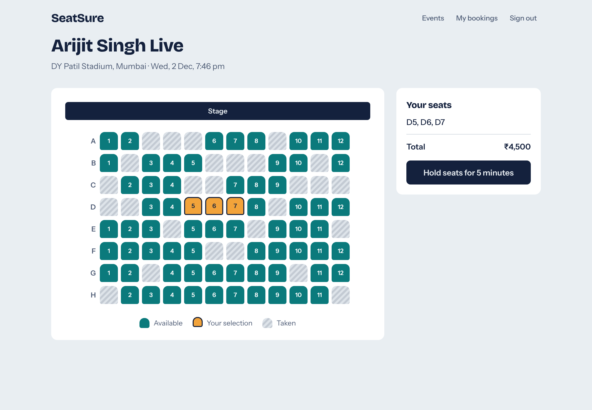
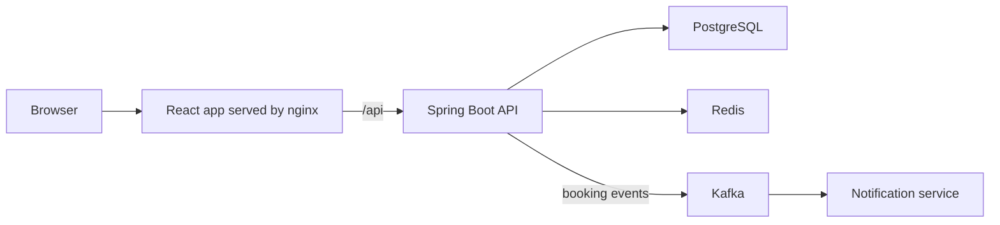

# SeatSure

SeatSure is a full-stack event ticketing application built around reliable seat reservations. Customers can browse events, choose seats from a live seat map, hold seats temporarily, complete a simulated payment, and view their bookings.

> **Live demo:** Not deployed yet. Follow [Deploy the application](#deploy-the-application) to publish a working demo. Pushing this repository to GitHub makes the source code available; it does not host the application.





## Features

- Browse events and inspect seat availability.
- Register, sign in, and manage bookings.
- Hold up to six seats for five minutes; expired holds are released automatically.
- Prevent double booking with Redis seat holds backed by PostgreSQL constraints.
- Process simulated payments with idempotency keys, decline handling, retries, and a circuit breaker.
- Publish booking events to Kafka and consume them in a separate notification service.
- Create events through an admin-only API.

## Architecture



The browser and API share an origin in the Docker deployment. Nginx proxies `/api` requests to the API. PostgreSQL stores durable application data, Redis manages short-lived seat holds and caching, and Kafka transports booking events to the notification service.

## Technology

| Area | Technologies |
|---|---|
| Frontend | React, TypeScript, Vite, React Query, Tailwind CSS |
| API | Java 21, Spring Boot, Spring Security, Spring Data JPA |
| Data | PostgreSQL, Flyway, Redis |
| Messaging | Apache Kafka, separate Spring Boot notification service |
| Reliability | Resilience4j, idempotent payment requests, database seat constraints |
| Delivery and observability | Docker Compose, GitHub Actions, Jenkins, Prometheus, Grafana |

## Run locally

### Prerequisites

- Docker Desktop with Docker Compose on Windows or macOS, or Docker Engine with the Compose plugin on Linux.
- Git, if cloning the repository.

### Start the stack

From the repository root, copy the example environment file and set a private JWT secret and database password. Do not commit `.env`.

PowerShell:

```powershell
Copy-Item .env.example .env
```

Then edit `.env` and start the application:

```powershell
docker compose up -d --build
```

| Service | Local URL |
|---|---|
| Web application | http://localhost:3000 |
| Swagger UI | http://localhost:8080/swagger-ui.html |
| API health | http://localhost:8080/actuator/health |

The example configuration enables demo data and creates `demo@seatsure.dev` and `admin@seatsure.dev` using the configured `APP_SEED_PASSWORD`. This is for local development only. Change the example password before use, and disable seeding for a public deployment.

The simulated payment gateway does not contact a payment provider or charge real money. The UI offers a successful test payment, a declined payment, and a simulated provider outage.

### Useful commands

```powershell
docker compose logs -f api
docker compose logs notification
docker compose stop
docker compose down
```

`docker compose down -v` also deletes the local database volume and its data.

To start the optional monitoring services:

```powershell
docker compose --profile monitoring up -d
```

Prometheus is available at http://localhost:9090 and Grafana at http://localhost:3001. Change `GRAFANA_PASSWORD` in `.env` before exposing or sharing a monitoring instance.

## Tests and CI

GitHub Actions runs backend and notification-service Maven verification and builds the frontend on pushes to `main` and on pull requests.

Run the backend tests:

```powershell
Set-Location backend
mvn verify
```

Testcontainers integration tests require Docker to be available. Run the frontend checks:

```powershell
Set-Location frontend
npm ci
npm run build
```

The test suite includes booking lifecycle and concurrency, payment idempotency, authentication, and JWT tests.

## Publish the source to GitHub

Create a **new empty GitHub repository** (do not initialize it with a README, license, or `.gitignore`). Then, from the project root in PowerShell, initialize and push the source:

```powershell
git init -b main
git add .
git status
```

Before committing, confirm that `.env` is not listed in the staged files. If it is staged, unstage it with `git rm --cached .env`; never push real secrets.

```powershell
git commit -m "Initial SeatSure release"
git remote add origin https://github.com/YOUR-USERNAME/seatsure.git
git push -u origin main
```

Replace `YOUR-USERNAME` with your GitHub username. The GitHub repository page is the **source-code link**, not the live application. The CI workflow starts running after the push; check its status under the repository's **Actions** tab.

## Deploy the application

The repository includes a production Compose override that keeps the database, Redis, Kafka, API, and web ports private and uses Caddy to obtain and renew an HTTPS certificate. It needs a Linux server with Docker Compose, a public IP, and ports 80 and 443 open. The complete stack is resource-intensive; plan for a server with at least 4 GB RAM.

1. Create a Linux VPS and point a domain or supported dynamic DNS name to its public IP.
2. Install Docker Engine and the Docker Compose plugin on the server.
3. Clone your GitHub repository and move into the project directory.
4. Create `.env` from `.env.example`. Set unique strong values for `JWT_SECRET`, `DB_PASSWORD`, `APP_SEED_PASSWORD`, and `GRAFANA_PASSWORD`; set `DOMAIN` to the hostname pointing to the server.
5. Set `APP_SEED_ENABLED=false` for a public deployment. If seeding is intentionally enabled for a portfolio demo, use a unique strong demo password and do not reuse it elsewhere.
6. Start the production stack:

```bash
docker compose -f docker-compose.yml -f docker-compose.prod.yml up -d --build
```

When Caddy has issued the certificate, the application will be available at `https://YOUR-DOMAIN`. Check startup with:

```bash
docker compose -f docker-compose.yml -f docker-compose.prod.yml ps
docker compose -f docker-compose.yml -f docker-compose.prod.yml logs -f caddy
```

After you verify the deployed app, replace the **Live demo** line at the top of this README with the real URL. GitHub Pages alone is not sufficient for this project: it can host static frontend files but not the Spring API and its PostgreSQL, Redis, and Kafka services.

## Add it to your resume

Once deployed, add the live URL and source repository to your resume. For example:

> **SeatSure — Event Ticket Booking Platform** | Java, Spring Boot, React, TypeScript, PostgreSQL, Redis, Kafka, Docker  
> Built a full-stack ticketing app with expiring seat holds, concurrency-safe bookings, idempotent simulated payments, and asynchronous booking notifications.  
> **Live demo:** `https://YOUR-DOMAIN` · **Source:** `https://github.com/YOUR-USERNAME/seatsure`

Only list a live demo after it is deployed and tested. Keep the resume concise, and link to the screenshots and technical details in this repository for more context.

## API overview

| Method | Endpoint | Description |
|---|---|---|
| `POST` | `/api/v1/auth/register`, `/api/v1/auth/login`, `/api/v1/auth/refresh` | Register and authenticate |
| `GET` | `/api/v1/events`, `/api/v1/events/{id}`, `/api/v1/events/{id}/seats` | Browse events and seat availability |
| `POST` | `/api/v1/bookings` | Hold seats for an event |
| `GET` | `/api/v1/bookings`, `/api/v1/bookings/{id}` | View your bookings |
| `POST` | `/api/v1/bookings/{id}/cancel` | Cancel an unpaid booking |
| `POST` | `/api/v1/bookings/{id}/payments` | Pay for a booking with an `Idempotency-Key` header |
| `POST` | `/api/v1/admin/events` | Create an event (admin only) |

## Repository layout

```text
backend/                  Spring Boot API and Flyway database migrations
notification-service/     Kafka consumer for booking notifications
frontend/                 React and TypeScript application
docs/screenshots/         Application screenshots
monitoring/               Prometheus and Grafana configuration
.github/workflows/        GitHub Actions CI
docker-compose.yml        Local development stack
docker-compose.prod.yml   Production networking and HTTPS proxy
Jenkinsfile               Jenkins pipeline
```

## Notes and limitations

- Payments are simulated; no real payment provider is integrated.
- Notifications are logged by the demo notification service rather than sent as real email.
- Kafka publishing is not transactionally coupled to the database. A transactional outbox would prevent event loss if the broker is unavailable at commit time.
- Access and refresh tokens are stored in browser local storage. A production-grade public service should consider a stricter content security policy and secure, httpOnly cookies.
- Production deployment requires operational care: secure secrets, backups, updates, monitoring, and a managed database or a tested database backup/restore process.
