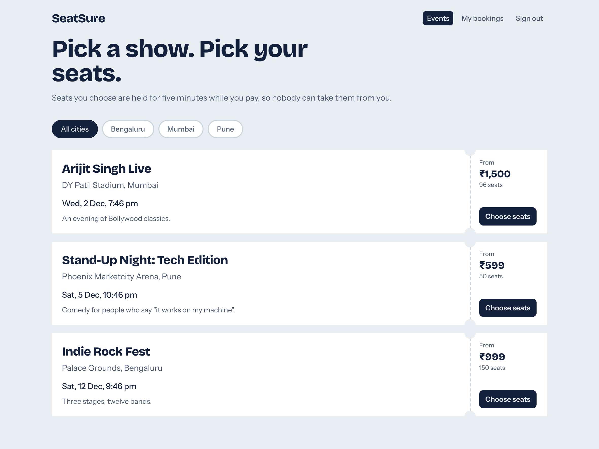
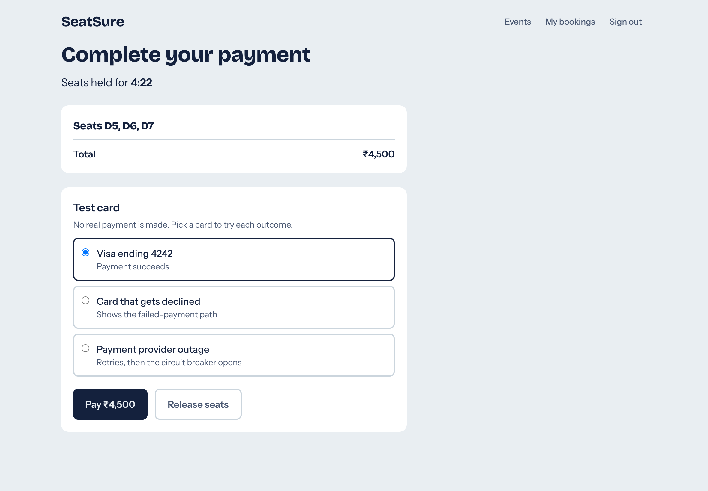
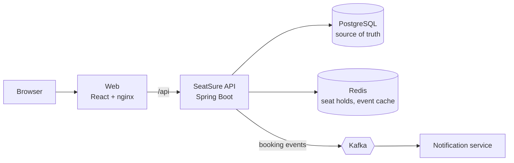

# SeatSure

[](https://github.com/tejaltatiwar/SeatSure/actions/workflows/ci.yml)

An event seat-booking platform. Browse events, pick seats on a live map, hold them for five minutes, pay, and get a confirmation. It is built around one hard problem: staying correct when many people want the same seat at the same moment.

**Try it:** run it locally with one command (see [Run it locally](#run-it-locally)), sign in as `demo@seatsure.dev`, pick seats, and pay with the test card **Visa ending 4242**. No real payment is made.





## Features

- **Browse and book.** Public event list and seat map. Signed-in customers hold up to 6 seats, pay, and see their bookings.
- **Seat holds that expire.** A hold lasts 5 minutes. If payment does not arrive, a scheduler frees the seats and notifies the customer.
- **Safe payments.** Paying twice with the same `Idempotency-Key` never charges twice. A declined card leaves the booking payable.
- **Async notifications.** Booking outcomes are published to Kafka and consumed by a separate service that sends the emails (logged in this demo).
- **Admin.** Admins create events and their seat grid through `POST /api/v1/admin/events`.

## Architecture



One deployable API with clear module boundaries (auth, event, booking, payment), plus one separate service where async decoupling pays off. Full microservices would add cost without solving a problem of this size.

## Tech stack

| Area | Technology |
|---|---|
| Backend | Java 21, Spring Boot 3, Spring Security (JWT), Spring Data JPA |
| Data | PostgreSQL, Flyway migrations, Redis (holds and caching) |
| Messaging | Apache Kafka (KRaft mode) |
| Resilience | Resilience4j (retry, circuit breaker, rate limiter) |
| Frontend | React 19, TypeScript, Vite, React Query, Tailwind CSS |
| Testing | JUnit 5, Mockito, Testcontainers, Postman collection |
| DevOps | Docker, Docker Compose, GitHub Actions, Jenkinsfile, Prometheus and Grafana |

## Design decisions

**Two layers stop double booking.**
1. Redis `SET key value NX EX 300` per seat: exactly one caller wins, and the TTL frees abandoned holds. Fast, and it absorbs almost all contention.
2. A partial unique index in PostgreSQL, `UNIQUE (seat_id) WHERE active`, is the real guarantee. If Redis is flushed or fails over, the database still refuses a second owner.

**Idempotent payments.** The client sends an `Idempotency-Key`. The booking row is locked (`SELECT ... FOR UPDATE`), the key is checked after the lock, and a replay returns the original result. A key reused for a different booking is rejected.

**Resilience around the payment provider.** Retry (3 attempts) wraps a circuit breaker. When the provider is down, requests fail with a clear 503 and the seats stay held.

**Events only after commit.** Kafka messages are sent from an `AFTER_COMMIT` listener, so a rolled-back booking never announces itself. Messages are keyed by booking id, so one booking's events stay in order.

**Schema owned by Flyway.** Migrations are in `backend/src/main/resources/db/migration`. Hibernate runs with `ddl-auto=validate` and only checks that the entities match.

**Security.** BCrypt passwords, short-lived access tokens (15 min) and refresh tokens (7 days) that cannot be used in place of each other, stateless API, role-based admin routes, per-IP rate limit on login and register, other users' bookings reported as "not found" so ids cannot be probed, uniform JSON errors with stable codes.

## Run it locally

Requires Docker (Docker Desktop on Windows and Mac).

```bash
cp .env.example .env        # Windows: copy .env.example .env
# edit .env and set JWT_SECRET to a random string of at least 32 characters
docker compose up -d --build
```

| What | Where |
|---|---|
| App | http://localhost:3000 |
| API docs (Swagger UI) | http://localhost:8080/swagger-ui.html |
| Health | http://localhost:8080/actuator/health |

With `APP_SEED_ENABLED=true` (the default in `.env.example`), demo users and three events are created on first start: `demo@seatsure.dev` (customer) and `admin@seatsure.dev` (admin), password from `APP_SEED_PASSWORD`.

Useful commands:

```bash
docker compose logs -f api                 # follow the API log
docker compose logs notification           # see the notification emails
docker compose stop                        # stop everything, keep data
docker compose down -v                     # remove everything, including the database
docker compose --profile monitoring up -d  # add Prometheus (:9090) and Grafana (:3001)
```

## Testing

**Postman.** Import `postman/SeatSure.postman_collection.json` and run it with the Collection Runner. It has 37 requests with tests covering auth, booking, payment idempotency, seat conflicts, cancellation and admin rules. Run folder 6 (provider outage) by hand.

**Automated tests.** They run on every push in GitHub Actions. To run them yourself:

```bash
cd backend
mvn verify                                          # all tests, needs Docker for Testcontainers
mvn test -Dtest='BookingTest,JwtServiceTest'        # fast unit tests only
```

- `BookingTest`, `JwtServiceTest`: booking lifecycle and token rules.
- `BookingConcurrencyIntegrationTest`: 12 buyers race for one seat and exactly one wins; a second test deletes the Redis hold on purpose and shows PostgreSQL still blocks the double booking.
- `PaymentIdempotencyIntegrationTest`: same key charges once, declined card keeps the booking payable, a key cannot be reused across bookings.
- `AuthFlowIntegrationTest`: register, duplicate email, login, 401 and 403 paths.

Integration tests start real PostgreSQL and Redis with Testcontainers and build the schema from the Flyway migrations. Kafka is mocked.

## Deploy to a server

Needs a Linux server with at least 4 GB of RAM (the stack runs two JVMs, Kafka, PostgreSQL and Redis) and ports 80 and 443 open.

```bash
git clone https://github.com/tejaltatiwar/SeatSure.git && cd SeatSure
cp .env.example .env
# set JWT_SECRET, DB_PASSWORD, APP_SEED_PASSWORD, and DOMAIN (for example seatsure.203-0-113-10.sslip.io)
docker compose -f docker-compose.yml -f docker-compose.prod.yml up -d --build
```

`docker-compose.prod.yml` stops publishing the database, Redis, Kafka and API ports, and adds Caddy, which serves the site over HTTPS with an automatic certificate. Only ports 80 and 443 are reachable from outside.

## API overview

| Method | Path | Notes |
|---|---|---|
| POST | `/api/v1/auth/register`, `/login`, `/refresh` | Public, rate limited |
| GET | `/api/v1/events`, `/events/{id}`, `/events/{id}/seats` | Public. Listing cached in Redis for 60 s |
| POST | `/api/v1/bookings` | Hold seats `{eventId, seatIds}` |
| GET | `/api/v1/bookings`, `/bookings/{id}` | Your bookings |
| POST | `/api/v1/bookings/{id}/cancel` | Release an unpaid booking |
| POST | `/api/v1/bookings/{id}/payments` | Header `Idempotency-Key`. 201 paid, 402 declined, 503 provider down |
| POST | `/api/v1/admin/events` | Admin only |

Errors look like `{ "status": 409, "code": "SEAT_UNAVAILABLE", "message": "...", "path": "..." }`.

## Project structure

```
backend/               Spring Boot API (auth, event, booking, payment modules)
notification-service/  Kafka consumer that sends booking notifications
frontend/              React + TypeScript app (served by nginx in Docker)
postman/               API test collection
monitoring/            Prometheus and Grafana configuration
docker-compose.yml     Full local stack
docker-compose.prod.yml  Production overrides (HTTPS, no exposed internals)
Jenkinsfile            Build, test, publish and deploy pipeline
.github/workflows/     GitHub Actions CI
```

## Trade-offs and next steps

- **Payments are simulated.** `PaymentGateway` is a port with a simulated implementation (test cards `tok_visa`, `tok_decline`, `tok_timeout`). Integrating Razorpay or Stripe means a new implementation plus a signed webhook for confirmation.
- **Kafka publishing is not transactional with the database.** If the broker is down at commit time, the message is lost. A transactional outbox table would fix this.
- **The payment call happens while the booking row is locked.** Fine at this scale. At higher volume, split into "reserve payment" and "confirm on webhook".
- **Tokens are stored in `localStorage`.** Add a strict Content-Security-Policy, or move the refresh token to an httpOnly cookie.
- **Expiry sweep runs every 30 s,** so a seat can look taken for up to 30 s after its hold ends.
- **Next:** Redis-backed distributed rate limiting, a load test with published results, and OpenTelemetry tracing.
